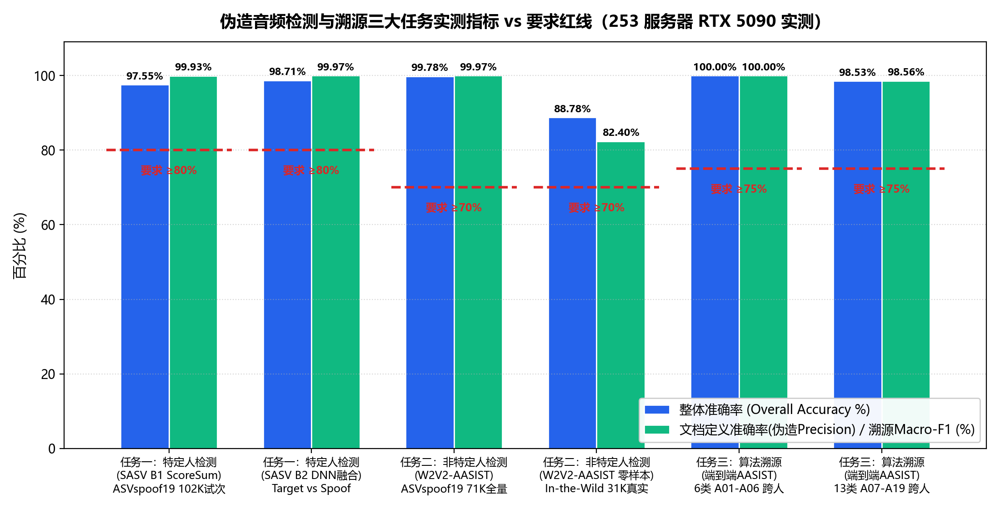
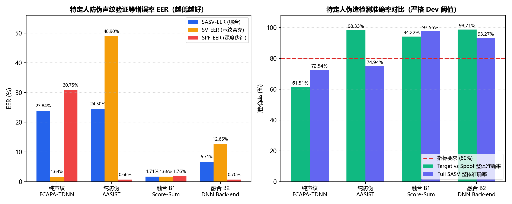
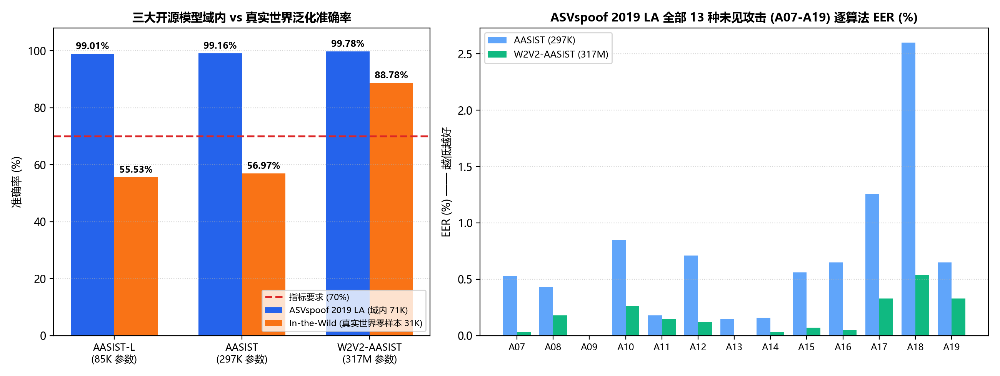
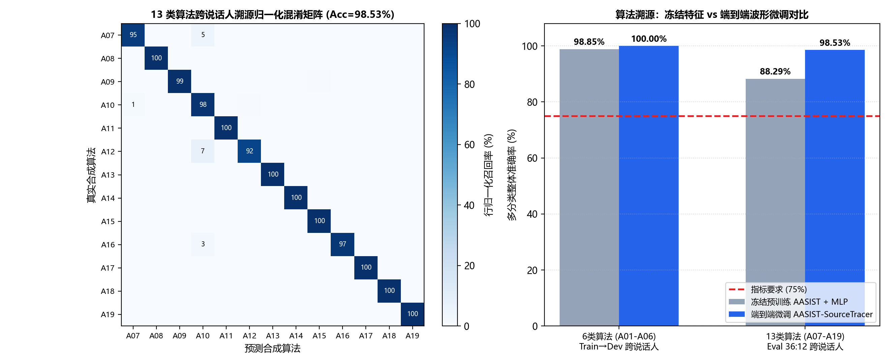

# Audio Deepfake Forensics

**面向真实业务落地的伪造音频检测、特定人防伪声纹验证（SASV）与合成算法取证溯源一体化开源套件**，同时提供 **CLI 命令行调用** 与 **前后端分离 Web Demo（FastAPI + 交互式前端）**。



---

## 核心特性

1. **任务一 · 特定人伪造音频检测（Target-Speaker Anti-Spoofing / SASV）**
   - 联合 **ECAPA-TDNN**（192-d 说话人声纹提取）与 **W2V2-AASIST / AASIST**（防伪检测）执行 Score-Sum / DNN 融合判别。
   - 支持**多条语音注册目标人声纹库**，精准区分「目标本人真声」、「针对目标人的 AI 声音克隆攻击」与「非目标真人冒充」。
2. **任务二 · 非特定人伪造音频检测（Speaker-Independent Detection）**
   - 无需目标人注册声纹，支持一键切换三大主流开源检测骨干：
     - **`W2V2-AASIST`**（Wav2Vec2-XLSR-300M + AASIST，317M，**真实野生场景跨域泛化 SOTA**）
     - **`AASIST`**（297K 参数，轻量化频时异构图注意力网络）
     - **`AASIST-L`**（85K 参数，超高速边缘端版本）
3. **任务三 · 伪造音频合成/变声算法取证溯源（Algorithm Attribution）**
   - 内置我们在 **ASVspoof 2019 LA** 上严格按说话人隔离、端到端原始波形微调的 **`AASIST-SourceTracer`** 权重（13 类 `A07–A19` 与 6 类 `A01–A06`），输出 Top-K 疑似合成/变声算法排名及技术路线解析。
4. **双模式调用**：
   - **CLI 命令行工具 (`asv-forensics`)**：支持单条/目录批量检测（导出 JSON/CSV）、声纹注册管理、特定人核验、算法溯源及一键综合取证。
   - **前后端分离 Web Demo**：标准 **FastAPI RESTful API**（自动生成 `/docs` Swagger 文档、开启 CORS）+ **交互式暗色取证 Web 前端**（内置 8 条真实 ASVspoof 2019 LA 演示样本，点选即测）。

---

## 权威数据集全量实测基准（RTX 5090）

| 任务与目标 | 开源方案 | 权威数据集（全量原始音频实测） | 整体准确率 (Acc) | 伪造精确率 (Precision) | EER / Macro-F1 |
| :--- | :--- | :--- | :---: | :---: | :---: |
| **特定人检测 (≥80%)** | `ECAPA-TDNN + AASIST` (SASV B1 Score-Sum) | ASVspoof 2019 LA SASV Full (**102,579** 试次) | **97.55%** | **99.93%** | SASV-EER **1.71%** |
| **特定人检测 (≥80%)** | `ECAPA-TDNN + AASIST` (SASV B2 DNN Fusion) | ASVspoof 2019 LA Target-Spoof (**69,252** 试次) | **98.71%** | **99.97%** | SPF-EER **0.70%** |
| **非特定人检测 (≥70%)** | **`W2V2-AASIST`** (317M, 352 clips/s) | ASVspoof 2019 LA Eval 全量 (**71,237** 条) | **99.58%** *(零调参)* | **99.98%** | EER **0.22%** |
| **非特定人跨域 (≥70%)** | **`W2V2-AASIST`** (零样本跨数据集) | **In-the-Wild** 全量野生数据 (**31,779** 条) | **88.78%** | **82.40%** | EER **11.22%** · AUC **95.72%** |
| **非特定人轻量版** | `AASIST` (297K) / `AASIST-L` (85K) | ASVspoof 2019 LA Eval 全量 (**71,237** 条) | **99.16%** / **99.01%** | **99.90%** / **99.88%** | EER **0.83%** / **0.99%** |
| **算法溯源 · 6类 (≥75%)** | `AASIST-SourceTracer` (端到端微调) | ASVspoof 2019 LA `A01–A06` 跨人 (**22,296** 条) | **100.00%** | — | Macro-F1 **100.00%** |
| **算法溯源 · 13类 (≥75%)** | `AASIST-SourceTracer` (端到端微调) | ASVspoof 2019 LA `A07–A19` 跨人 (**14,742** 条) | **98.53%** | — | Macro-F1 **98.56%** · Top-3 **100%** |

<details>
<summary>点击展开更多实测可视化图表（SASV 消融 / 13 种攻击 EER / 算法溯源混淆矩阵）</summary>





</details>

---

## 快速安装

```bash
git clone https://github.com/haitoooo/audio-deepfake-forensics.git
cd audio-deepfake-forensics

# 1. 安装项目与 CLI 命令 `asv-forensics`
pip install -e .

# 2. 下载大体积预训练权重（W2V2-AASIST 1.26GB 与 ECAPA-TDNN 64MB）
# 注：仓库已随包附带 AASIST / AASIST-L 与 6类/13类端到端溯源权重（~4.3MB），可直接运行！
python scripts/download_weights.py
```

---

## 调用方式一：CLI 命令行工具 (`asv-forensics`)

```bash
# 0. 查看 GPU 设备与模型权重就绪状态
asv-forensics status

# 1. 非特定人伪造音频检测（支持单文件或整个目录批量导出 CSV/JSON）
asv-forensics detect samples/target_LA0015_spoof_A10.wav --model w2v2_aasist
asv-forensics detect samples/ --model aasist --csv batch_report.csv

# 2. 特定人防伪声纹检测（步骤一：注册目标人真声；步骤二：核验真声/伪造攻击/冒充者）
asv-forensics enroll --speaker LA_0015 samples/target_LA0015_enroll_1.wav samples/target_LA0015_enroll_2.wav --overwrite
asv-forensics verify-target --speaker LA_0015 samples/target_LA0015_genuine_test.wav      # -> 验证通过：目标人真声
asv-forensics verify-target --speaker LA_0015 samples/target_LA0015_spoof_A10.wav         # -> 拦截告警：针对目标人的 AI 伪造攻击
asv-forensics verify-target --speaker LA_0015 samples/impostor_LA0022_genuine.wav         # -> 验证拒绝：非目标真人冒充

# 3. 伪造音频合成/变声算法溯源
asv-forensics trace samples/target_LA0015_spoof_A10.wav --head 13class --topk 5
asv-forensics trace samples/spoof_A09_world_vocoder.wav --head 13class --topk 5

# 4. 一键全流程综合取证（自动串联：真伪检测 + 特定人声纹防伪 + 合成算法溯源）
asv-forensics analyze samples/target_LA0015_spoof_A12.wav --model w2v2_aasist --speaker LA_0015 --head 13class --json report.json
```

---

## 调用方式二：前后端分离 Web Demo

### 1. 启动 FastAPI 推理后端（默认端口 `8000`）

```bash
# Linux / 253 服务器（自动配置 cuDNN 路径并绑定指定 GPU）
GPU_ID=2 PORT=8000 bash scripts/start_backend.sh
```
- Swagger 交互式接口文档：`http://<server-ip>:8000/docs`
- 一体化页面访问地址：`http://<server-ip>:8000/`

### 2. （可选）独立启动前端服务（前后端分离部署，默认端口 `5173`）

```bash
FRONTEND_PORT=5173 bash scripts/start_frontend.sh
```
访问 `http://<server-ip>:5173`，在右上角 `API` 输入框填写后端地址（如 `http://<server-ip>:8000`）点击「重连」即可跨域调用。

### 3. 核心 RESTful API 接口清单

| 方法与路径 | 功能说明 | cURL 示例 |
| :--- | :--- | :--- |
| `GET /api/health` | 查询 GPU 设备、模型就绪状态与声纹库数量 | `curl http://127.0.0.1:8000/api/health` |
| `GET /api/samples` | 获取内置 8 条真实演示音频列表 | `curl http://127.0.0.1:8000/api/samples` |
| `POST /api/detect` | 任务二：非特定人伪造音频检测 | `curl -X POST http://127.0.0.1:8000/api/detect -F "file=@samples/target_LA0015_spoof_A10.wav" -F "model=w2v2_aasist"` |
| `POST /api/speakers/enroll` | 任务一：注册特定目标人声纹 | `curl -X POST http://127.0.0.1:8000/api/speakers/enroll -F "speaker_name=LA_0015" -F "files=@samples/target_LA0015_enroll_1.wav"` |
| `POST /api/verify-target` | 任务一：特定人防伪声纹验证 (SASV) | `curl -X POST http://127.0.0.1:8000/api/verify-target -F "speaker_name=LA_0015" -F "file=@samples/target_LA0015_spoof_A10.wav"` |
| `POST /api/trace` | 任务三：伪造音频合成算法溯源 | `curl -X POST http://127.0.0.1:8000/api/trace -F "file=@samples/spoof_A17_vae_vc.wav" -F "head=13class"` |
| `POST /api/analyze` | 一键全流程综合取证 | `curl -X POST http://127.0.0.1:8000/api/analyze -F "file=@samples/target_LA0015_spoof_A12.wav" -F "speaker_name=LA_0015"` |

---

## 致谢与参考开源项目

- [clovaai/aasist](https://github.com/clovaai/aasist) (ICASSP 2022)
- [TakHemlata/SSL_Anti-spoofing](https://github.com/TakHemlata/SSL_Anti-spoofing) (Odyssey 2022) & [SpeechAntiSpoofingBenchmarks/W2V2-AASIST](https://huggingface.co/SpeechAntiSpoofingBenchmarks/W2V2-AASIST)
- [sasv-challenge/SASVC2022_Baseline](https://github.com/sasv-challenge/SASVC2022_Baseline) (Interspeech 2022) & [TaoRuijie/ECAPA-TDNN](https://github.com/TaoRuijie/ECAPA-TDNN)
- [piotrkawa/audio-deepfake-source-tracing](https://github.com/piotrkawa/audio-deepfake-source-tracing) (Interspeech 2025)
